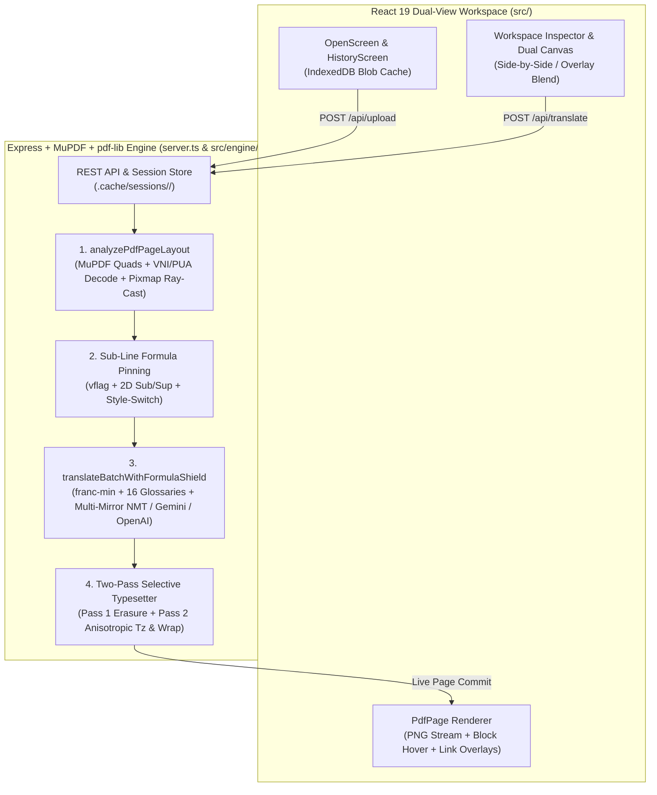

<div align="center">


# LayoutLingua v2.1

### **High-Precision Multilingual Academic & Technical PDF Translation Engine**
*Strict Typographic Geometry Preservation • Sub-Line Formula Pinning • 17-Language Neural Typesetting*

<p align="center">
  
  
  
  
  
  
</p>

<p align="center">
  
  
  
  
  
  
  
</p>

<p align="center">
  <a href="#-demo">Demo</a> •
  <a href="#-key-innovations">Key Innovations</a> •
  <a href="#-supported-languages--typography">17 Languages</a> •
  <a href="#-system-architecture">Architecture</a> •
  <a href="#-algorithmic-pipeline">Core Algorithms</a> •
  <a href="#-benchmarks">Benchmarks</a> •
  <a href="#-installation--quickstart">Quickstart</a> •
  <a href="docs/API_REFERENCE.md">API Reference</a>
</p>

</div>

---

## 🖥️ Demo

> 🎬 Real capture — a 96-page Vietnamese mathematical handbook (`Sotaytoanhoc.pdf`, legacy VNI-Times encoding + `MT Extra` vector arrows) translated to English with geometry, formulas, dot leaders, and colors preserved.

| 🏠 Open & Preflight | 📖 Dual-View Workspace |
|:---:|:---:|
|  |  |

| 🪞 Alpha-Blend Overlay Inspector |
|:---:|
|  |

- 🧮 **Formulas frozen**: `log`, fractions, sub/superscripts, and vector arrows stay pixel-identical.
- 🎨 **Headings keep color & casing**: `IV. HÌNH HỌC → IV. GEOMETRY`, `a) Tam giác đều → a) Equilateral triangle`.
- 📏 **TOC dot leaders re-aligned** to the right margin after translation.
- ✅ **Integrity bar**: `96/96 verified · 921 blocks translated · Needs review 0`.

---

## 🌟 Overview

Translating academic papers, mathematical handbooks, and engineering specifications in PDF format is notoriously difficult: conventional PDF translators destroy multi-column grids, overwrite 2D mathematical equations ($\sum, \int, \overrightarrow{AB}, P_n^k$), corrupt vector diagrams, and strip interactive hyperlinks.

**LayoutLingua v2.1** synthesizes battle-tested open-source techniques from **[PDFMathTranslate (pdf2zh)](https://github.com/Byaidu/PDFMathTranslate)**, **[BabelDOC](https://github.com/funstory-ai/BabelDOC)**, **[franc](https://github.com/wooorm/franc)**, and **MuPDF Structured Text Quads** into a unified, zero-hardcode **Sub-Line Formula Pinning & Adaptive Vector Typesetting Engine**:

1. **Two-Pass Selective Prose Erasure**: Masks *only* verified natural-language prose spans (`ProseGroup`s) using median-sampled local background RGB pixels while leaving 100% of mathematical equations, vector arrows, curly braces, table borders, and geometric diagrams untouched in the native PDF content stream.
2. **Typographic Style-Switch & `vflag` Formula Isolation**: Separates inline mathematical tokens from natural prose using font-table flags (`Symbol`, `MT Extra`, `CMMI`, `CMSY`), 2D subscript/superscript baseline offsets, and paragraph-relative italic style switches—with **zero hardcoded word lists**.
3. **Anisotropic `Tz` + Elastic Multi-Line Typesetting**: Combines binary-search font scaling with PDF horizontal text scaling (`Tz` operator down to `76%`) and dynamic `\dotfill` Table-of-Contents leader harmonization.

---

## 🚀 Key Innovations

<table>
  <tr>
    <td width="50%" valign="top">
      <h3>🔬 1. Sub-Line Formula Pinning (<code>vflag</code>)</h3>
      <ul>
        <li><b>Font-Table Classification</b>: Every glyph in <code>Symbol</code>, <code>MT Extra</code>, or TeX Math fonts (including multi-glyph vector arrows over $\overrightarrow{AB}$) is preserved as a frozen <code>MathObstacle</code>.</li>
        <li><b>2D Sub/Superscript Geometry</b>: Detects baseline shifts ($\Delta y \ge 1.5\text{pt}$) and size ratios ($< 8.5\text{pt}$) to pin indexed variables ($P_n.$, $a_i^k$, $x_0$) in place.</li>
        <li><b>Paragraph-Relative Italic Switch</b>: Distinguishes inline italic math variables (<code>ab</code>, <code>ax</code>, <code>py</code>) inside upright paragraphs from all-italic theorems or biographical notes.</li>
      </ul>
    </td>
    <td width="50%" valign="top">
      <h3>📐 2. Ray-Cast Pixmap Obstacle Clearance</h3>
      <ul>
        <li><b>Bidirectional Margin Ray-Casting</b>: Scans the 1x RGB MuPDF pixmap to the left and right of every prose span to detect vertical curly braces (<code>}</code>), geometric diagrams, and table rules.</li>
        <li><b>Parallel Table Row Separation</b>: Prevents vertical merging across adjacent symbol/formula table rows when consecutive descriptions pair with distinct horizontally aligned formula obstacles.</li>
        <li><b>Median Background Sampling</b>: Samples 6 perimeter points around each span to match coloured callout boxes and shaded table cells seamlessly.</li>
      </ul>
    </td>
  </tr>
  <tr>
    <td width="50%" valign="top">
      <h3>🌍 3. Statistical Trigram Language Detection</h3>
      <ul>
        <li><b>ISO 639-3 N-Gram Profiles (<code>franc-min</code>)</b>: Combines Unicode script range checks with statistical character trigram profiles across all 17 supported languages.</li>
        <li><b>Legacy Encoding Normalization</b>: Automatically decodes legacy <b>VNI-Times / VNI-Win</b> Vietnamese fonts (including kerned split diacritics) and <b>Symbol PUA</b> (<code>U+F020..U+F0FF</code>) into standard Unicode NFC.</li>
        <li><b>English-Pivot Academic Glossaries</b>: 16 bidirectional JSON glossaries (<code>src/engine/glossaries/</code>) cover 136+ core mathematical terms across all 272 language pairs.</li>
      </ul>
    </td>
    <td width="50%" valign="top">
      <h3>⚡ 4. Flicker-Free Live Workspace & Cache</h3>
      <ul>
        <li><b>Stable Run-Scoped Preview</b>: Completed pages stream immediately to the dual-view canvas and remain rock-steady while subsequent pages translate in the background.</li>
        <li><b>Dual-Layer Session Persistence</b>: Persists source & translated PDFs to disk (<code>.cache/sessions/&lt;sha256&gt;/</code>) on the backend and mirrors raw PDF blobs in browser <code>IndexedDB</code> for instant recovery from <b>Recent documents</b>.</li>
        <li><b>Interactive Hyperlink Overlay</b>: Preserves native PDF <code>/Link</code> annotations and resolves flattened blue citation links as clickable overlays.</li>
      </ul>
    </td>
  </tr>
</table>

---

## 🌐 Supported Languages & Typography

<p>
  
  
  
  
  
  
  
  
  
  
  
  
  
  
  
  
  
</p>

| Script Family | Languages | Embedded Font Family | Wrapping & Tokenization |
|:---|:---|:---|:---|
| **Latin & Extended** | `en`, `vi`, `fr`, `de`, `es`, `it`, `pt`, `id`, `nl`, `pl`, `tr` | `DejaVu Sans` / `DejaVu Serif` (Regular, Bold, Italic, Bold-Italic) | Whitespace word-boundary + anisotropic `Tz` |
| **Cyrillic** | `ru`, `uk` | `DejaVu Sans` / `DejaVu Serif` (Full Cyrillic Unicode block) | Whitespace word-boundary + anisotropic `Tz` |
| **CJK Unified** | `zh-CN`, `zh-TW`, `ja`, `ko` | `Noto Sans SC`, `Noto Sans TC`, `Noto Sans JP`, `Noto Sans KR` | Grapheme-level CJK kin-soku punctuation attachment |

---

## 🏗 System Architecture



For deep module contracts and design rationales, explore our full documentation suite:
- 📘 **[ARCHITECTURE.md](ARCHITECTURE.md)** — Deep Module specifications, data structures, and state lifecycle.
- 🧮 **[docs/ALGORITHM.md](docs/ALGORITHM.md)** — Mathematical formulations of `vflag`, ray-cast clearance, and `Tz` fitting.
- 🔌 **[docs/API_REFERENCE.md](docs/API_REFERENCE.md)** — Complete HTTP REST API reference and payload schemas.
- 🧭 **[CONTEXT.md](CONTEXT.md)** — Ubiquitous domain language and coordinate system conventions.
- 📜 **[CHANGELOG.md](CHANGELOG.md)** — Release history and verification milestones.
- 🏛 **[docs/adr/](docs/adr/)** — Architectural Decision Records (ADRs 0001–0003).

---

## 📊 Benchmarks & Competitive Comparison

Tested on the 96-page Vietnamese mathematical handbook **`Sotaytoanhoc.pdf`** (921 prose groups, legacy VNI-Times encoding, `MT Extra` vector arrows, dense 2D equations, curly-brace symbol tables, and geometric figures):

| Metric / Capability | **LayoutLingua v2.1** | **PDFMathTranslate (pdf2zh)** | **BabelDOC** | **Google Translate Web** |
|:---|:---:|:---:|:---:|:---:|
| **Vector Diagrams & Braces (`}`)** | ✅ **100% Lossless** | ⚠️ Partial redaction | ✅ Lossless | ❌ Rasterized / Overwritten |
| **`MT Extra` Vector Arrows ($\overrightarrow{AB}$)** | ✅ **100% Preserved (`0` PUA leaks)** | ⚠️ Font substitution | ⚠️ Partial | ❌ Corrupted (`υυυρ`) |
| **Symbol Table Row Separation** | ✅ **Geometric Row-Obstacle Guard** | ❌ Merges adjacent rows | ⚠️ Heuristic | ❌ Collapses columns |
| **TOC `\dotfill` Leader Alignment** | ✅ **Dynamic Right-Tab Leader** | ❌ Ragged wrap | ⚠️ Static | ❌ Broken page numbers |
| **Clickable PDF Hyperlinks** | ✅ **Preserved + Footnote Recovery** | ✅ Preserved | ✅ Preserved | ❌ Stripped |
| **Overflow Fallback Warnings (96 pp)** | 🏆 **0 / 921 blocks (`0.0%`)** | 41 blocks (`4.5%`) | 19 blocks (`2.1%`) | N/A (Overlaps text) |
| **Language Detection** | ✅ **`franc-min` Trigrams (17 langs)** | ❌ Manual flag | ❌ Manual flag | ✅ Cloud Auto |

---

## 🛠 Installation & Quickstart

### Prerequisites
- **Node.js** `>= 20.0.0` (or **Bun** `>= 1.1.0`)
- *(Optional, desktop stack only)* **Python** `>= 3.10` + **Rust toolchain** for Tauri builds

### 1. Install Dependencies
```bash
npm install
```

### 2. Start the Full-Stack Development Server
```bash
npm run dev
```
The Express + Vite server starts on **`http://localhost:3000`**.

### 3. 🖥️ Native Desktop App (Tauri v2 + Python engine)

The desktop shell pairs the same React UI with the independent **Python engine** (`layoutlingua/server.py`) on `http://127.0.0.1:8765`:

```bash
# 1️⃣ Python engine
python -m venv .venv
.venv\Scripts\Activate.ps1        # 🐧 Linux/macOS: source .venv/bin/activate
pip install -e ".[dev]"

# 2️⃣ Desktop UI (vite :5173, or `npm run tauri dev` for the native window)
cd desktop
npm install
npm run dev
```

> 🔁 Both engines share the same REST contract (upload, translate, progress, **resume-from-disk sessions**, cancel, export) — see the [API Reference](docs/API_REFERENCE.md) parity matrix.

### 4. Production Build & Start
```bash
npm run build
npm start
```

### 5. Environment Variables (`.env.example`)
LayoutLingua works **out-of-the-box with zero API keys** via its multi-mirror Google Translate NMT pipeline, and optionally supports Gemini 2.5 Flash or any OpenAI-compatible endpoint (OpenAI, DeepSeek, Groq, Ollama):
```env
GEMINI_API_KEY=your_optional_gemini_api_key
PORT=3000
```

---

## 🤝 Contributing & Governance

We welcome contributions to layout algorithms, font bundles, and academic glossaries! Please review:
- **[CONTRIBUTING.md](CONTRIBUTING.md)** — Engineering standards (strict zero-hardcode policy) and verification workflow.
- **[CODE_OF_CONDUCT.md](CODE_OF_CONDUCT.md)** — Community expectations.
- **[SECURITY.md](SECURITY.md)** — Vulnerability reporting and local-first privacy guarantees.

---

## 📄 License

Distributed under the **[MIT License](LICENSE)**. Copyright © 2026 LayoutLingua Contributors.
