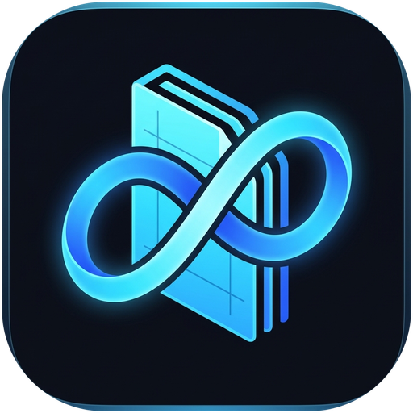
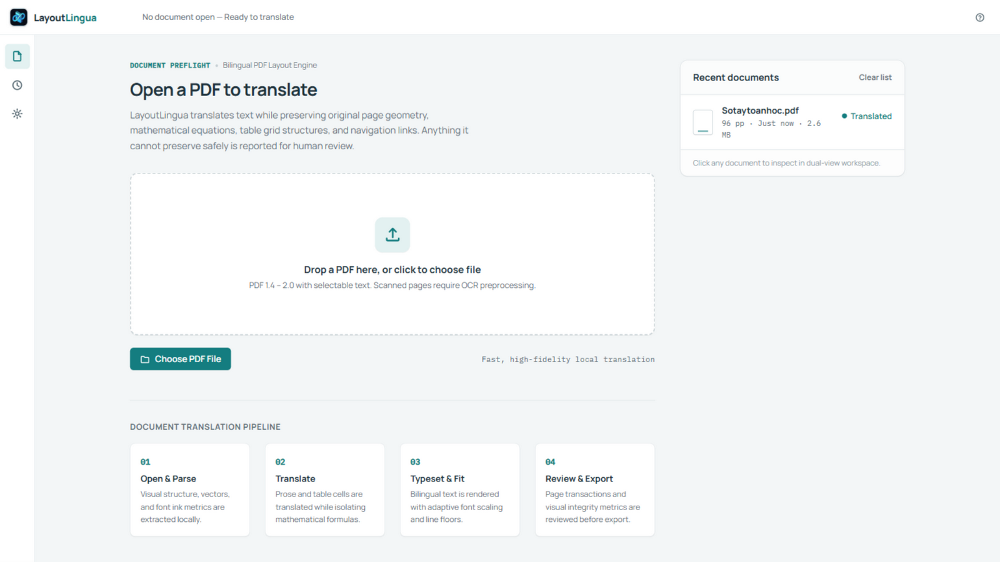
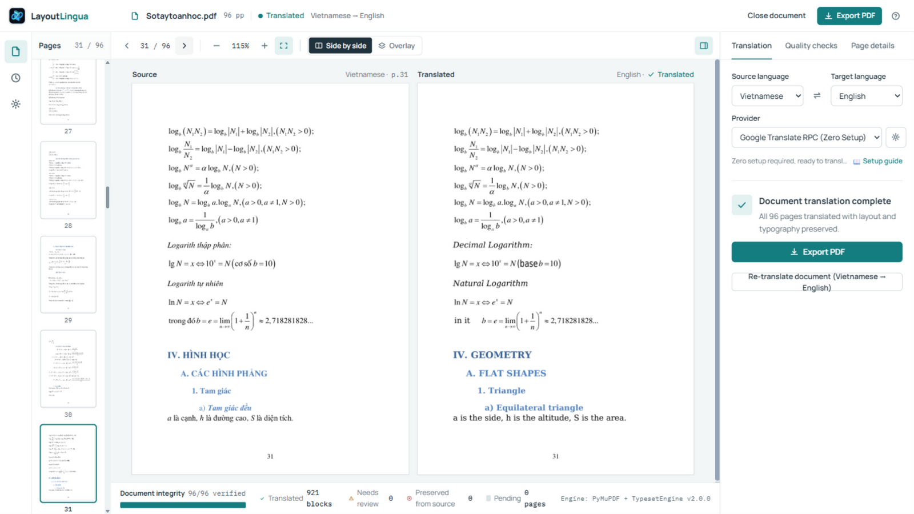
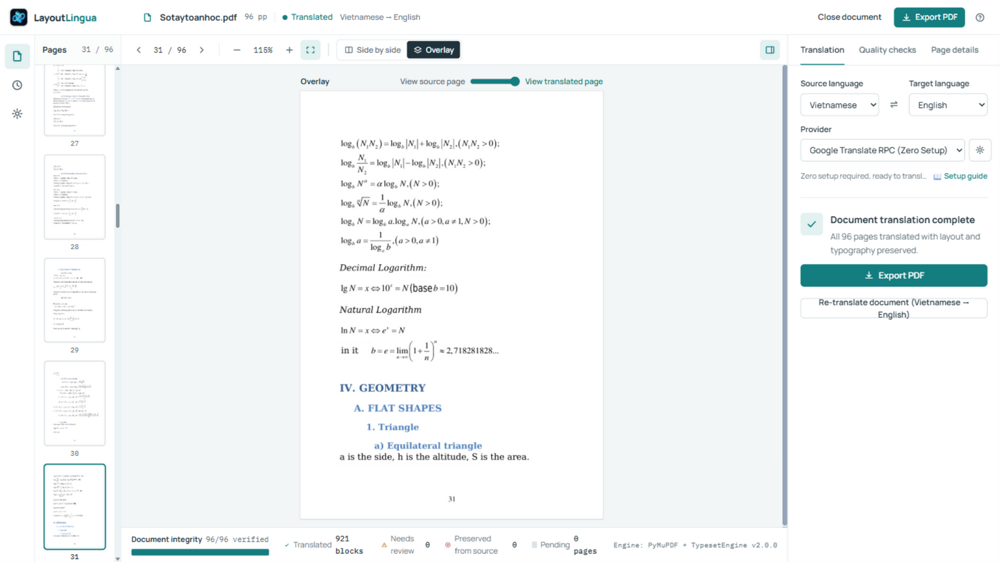
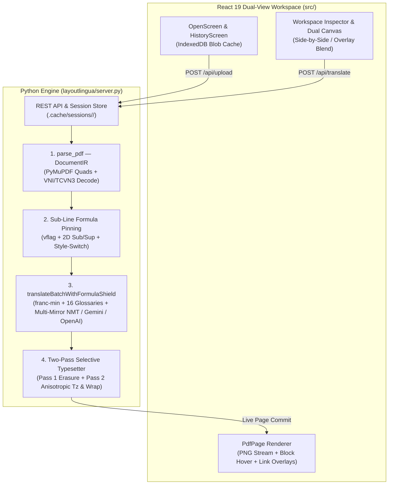

<div align="center">



# 🚀 LayoutLingua v2.1.2 🌟

### **High-Precision Multilingual Academic & Technical PDF Translation Engine**
*Strict Typographic Geometry Preservation 📐 • Sub-Line Formula Pinning 🧮 • 17-Language Neural Typesetting 🌍*

<p align="center">
  
  
  
  
  
  
  
</p>

<p align="center">
  
  
  
  
  
  
  
</p>

<p align="center">
  <a href="#-demo">🖥️ Demo</a> •
  <a href="#-key-innovations">✨ Key Innovations</a> •
  <a href="#-universal-translation-providers">🤖 Providers & Offline AI</a> •
  <a href="#-supported-languages--typography">🌍 17 Languages</a> •
  <a href="#-system-architecture">🏛 Architecture</a> •
  <a href="#-algorithmic-pipeline">🧮 Core Algorithms</a> •
  <a href="#-benchmarks">📊 Benchmarks</a> •
  <a href="#-installation--quickstart">🛠 Quickstart</a> •
  <a href="#-rest-api-contract">🔌 API Reference</a> •
  <a href="#-documentation">📚 Documentation</a>
</p>

</div>

---

## 🖥️ Demo

> 🎬 Real capture — a 96-page Vietnamese mathematical handbook (legacy VNI-Times encoding + `MT Extra` vector arrows) translated to English with geometry, formulas, dot leaders, and colors preserved.

| 🏠 Open & Preflight | 📖 Dual-View Workspace |
|:---:|:---:|
|  |  |

| 🪞 Alpha-Blend Overlay Inspector |
|:---:|
|  |

- 🧮 **Formulas frozen**: `log`, fractions, sub/superscripts, and vector arrows stay pixel-identical.
- 🎨 **Headings keep color & casing**: `IV. HÌNH HỌC → IV. GEOMETRY`, `a) Tam giác đều → a) Equilateral triangle`.
- 📏 **TOC dot leaders re-aligned** to the right margin after translation.
- ✅ **Integrity bar**: `96/96 verified · 921 blocks translated · Needs review 0`.

---

## 🌟 Overview

Translating academic papers, mathematical handbooks, and engineering specifications in PDF format is notoriously difficult: conventional PDF translators destroy multi-column grids, overwrite 2D mathematical equations ($\sum, \int, \overrightarrow{AB}, P_n^k$), corrupt vector diagrams, and strip interactive hyperlinks.

**LayoutLingua v2.0** synthesizes battle-tested open-source techniques from **[PDFMathTranslate (pdf2zh)](https://github.com/Byaidu/PDFMathTranslate)**, **[BabelDOC](https://github.com/funstory-ai/BabelDOC)**, **[franc](https://github.com/wooorm/franc)**, and **MuPDF Structured Text Quads** into a unified, zero-hardcode **Sub-Line Formula Pinning & Adaptive Vector Typesetting Engine**:

1. **Two-Pass Selective Prose Erasure**: Masks *only* verified natural-language prose spans (`ProseGroup`s) using median-sampled local background RGB pixels while leaving 100% of mathematical equations, vector arrows, curly braces, table borders, and geometric diagrams untouched in the native PDF content stream.
2. **Typographic Style-Switch & `vflag` Formula Isolation**: Separates inline mathematical tokens from natural prose using font-table flags (`Symbol`, `MT Extra`, `CMMI`, `CMSY`), 2D subscript/superscript baseline offsets, and paragraph-relative italic style switches—with **zero hardcoded word lists**.
3. **Anisotropic `Tz` + Elastic Multi-Line Typesetting**: Combines binary-search font scaling with PDF horizontal text scaling (`Tz` operator down to `76%`) and dynamic `\dotfill` Table-of-Contents leader harmonization.

---

## 🚀 Key Innovations

<table>
  <tr>
    <td width="50%" valign="top">
      <h3>🔬 1. Sub-Line Formula Pinning (<code>vflag</code>)</h3>
      <ul>
        <li><b>Font-Table Classification</b>: Every glyph in <code>Symbol</code>, <code>MT Extra</code>, or TeX Math fonts (including multi-glyph vector arrows over $\overrightarrow{AB}$) is preserved as a frozen <code>MathObstacle</code>.</li>
        <li><b>2D Sub/Superscript Geometry</b>: Detects baseline shifts ($\Delta y \ge 1.5\text{pt}$) and size ratios ($< 8.5\text{pt}$) to pin indexed variables ($P_n.$, $a_i^k$, $x_0$) in place.</li>
        <li><b>Paragraph-Relative Italic Switch</b>: Distinguishes inline italic math variables (<code>ab</code>, <code>ax</code>, <code>py</code>) inside upright paragraphs from all-italic theorems or biographical notes.</li>
      </ul>
    </td>
    <td width="50%" valign="top">
      <h3>📐 2. Ray-Cast Pixmap Obstacle Clearance</h3>
      <ul>
        <li><b>Bidirectional Margin Ray-Casting</b>: Scans the 1x RGB MuPDF pixmap to the left and right of every prose span to detect vertical curly braces (<code>}</code>), geometric diagrams, and table rules.</li>
        <li><b>Parallel Table Row Separation</b>: Prevents vertical merging across adjacent symbol/formula table rows when consecutive descriptions pair with distinct horizontally aligned formula obstacles.</li>
        <li><b>Median Background Sampling</b>: Samples 6 perimeter points around each span to match coloured callout boxes and shaded table cells seamlessly.</li>
      </ul>
    </td>
  </tr>
  <tr>
    <td width="50%" valign="top">
      <h3>🌍 3. Statistical Trigram Language Detection</h3>
      <ul>
        <li><b>ISO 639-3 N-Gram Profiles (<code>franc-min</code>)</b>: Combines Unicode script range checks with statistical character trigram profiles across all 17 supported languages.</li>
        <li><b>Legacy Encoding Normalization</b>: Automatically decodes legacy <b>VNI-Times / VNI-Win</b> Vietnamese fonts (including kerned split diacritics) and <b>Symbol PUA</b> (<code>U+F020..U+F0FF</code>) into standard Unicode NFC.</li>
        <li><b>English-Pivot Academic Glossaries</b>: 16 bidirectional JSON glossaries (<code>layoutlingua/resources/glossary/</code>) cover 136+ core mathematical terms across all 272 language pairs.</li>
      </ul>
    </td>
    <td width="50%" valign="top">
      <h3>⚡ 4. Flicker-Free Live Workspace & Cache</h3>
      <ul>
        <li><b>Stable Run-Scoped Preview</b>: Completed pages stream immediately to the dual-view canvas and remain rock-steady while subsequent pages translate in the background.</li>
        <li><b>Dual-Layer Session Persistence</b>: Persists source & translated PDFs to disk (<code>.cache/sessions/&lt;sha256&gt;/</code>) on the backend and mirrors raw PDF blobs in browser <code>IndexedDB</code> for instant recovery from <b>Recent documents</b>.</li>
        <li><b>Interactive Hyperlink Overlay</b>: Preserves native PDF <code>/Link</code> annotations and resolves flattened blue citation links as clickable overlays.</li>
      </ul>
    </td>
  </tr>
</table>

---

## 🌐 Supported Languages & Typography

<p>
  
  
  
  
  
  
  
  
  
  
  
  
  
  
  
  
  
</p>

| Script Family | Languages | Embedded Font Family | Wrapping & Tokenization |
|:---|:---|:---|:---|
| **Latin & Extended** | `en`, `vi`, `fr`, `de`, `es`, `it`, `pt`, `id`, `nl`, `pl`, `tr` | `DejaVu Sans`, `DejaVu Serif`, `FreeSans`, `FreeSerif`, `DejaVu Sans Mono` (Full variant matrix) | Syllabic hyphenation + whitespace boundary + anisotropic `Tz` |
| **Cyrillic** | `ru`, `uk` | `DejaVu Sans` / `DejaVu Serif` / `FreeSerif` (Full Cyrillic Unicode block) | Whitespace word-boundary + anisotropic `Tz` |
| **CJK Unified** | `zh-CN`, `zh-TW`, `ja`, `ko` | `Noto Sans CJK` / PyMuPDF CJK font fallbacks (`china-s`, `china-t`, `japan`, `korea`) | Grapheme-level CJK kin-soku punctuation attachment + CJK inline fallback |

---

## 🤖 Universal Translation Providers & Offline AI Engine

LayoutLingua supports 4 distinct translation tracks designed for maximum privacy, accuracy, and ease of use:

| Provider | Type | Privacy & Cost | Key Capabilities & Auto-Healing |
|:---|:---:|:---:|:---|
| 🌐 **Google Translate RPC** | Web NMT | Free • Zero Setup | Instant batching with multi-mirror fallback, 17 languages, zero API keys required. |
| 🧠 **Google AI Studio (Gemini)** | Cloud LLM | Free/Paid Tier | **Auto-Healing 404 Deprecation**: automatically discovers newest Flash models if an older model ID is retired; supports `auto`, `gemini-2.5-flash`, `gemini-flash-latest`. |
| 🦙 **Local LLMs & OpenAI-Compatible** | Local / Cloud | 100% Private (Local) | Zero-dependency `native_rest` fallback. Direct support for **Local Ollama** (`localhost:11434`), **LM Studio** (`localhost:1234`), DeepSeek, Groq, and OpenRouter. |
| 📦 **Argos Translate (Offline AI)** | Local Neural | 100% Air-Gapped Offline | CTranslate2 local neural inference with zero internet connection or API keys. One-click runtime and language package download directly from Settings UI. |

> ⚡ **Live Provider Connection Test**: Click **Test Connection** in Settings to measure round-trip latency (ms) and verify formula token invariance (`<b0></b0>`) in real-time before starting translations! 🎯

---

## 🏗 System Architecture



Every deep-dive lives in [`docs/`](docs/) — this README is the hub that links them all, and each doc links back here. 🗺️

- 📘 **[docs/ARCHITECTURE.md](docs/ARCHITECTURE.md)** — Deep Module specifications, data structures, and state lifecycle.
- 🧮 **[docs/ALGORITHM.md](docs/ALGORITHM.md)** — Mathematical formulations: `vflag` pinning, ray-cast clearance, table guards, anisotropic `Tz` fitting.
- 🔌 **[docs/API_REFERENCE.md](docs/API_REFERENCE.md)** — Full dual-engine REST contract with payload schemas.
- 🧭 **[docs/CONTEXT.md](docs/CONTEXT.md)** — Ubiquitous domain language and coordinate system conventions.
- 📜 **[docs/CHANGELOG.md](docs/CHANGELOG.md)** — Release history and verification milestones.
- 🤝 **[docs/CONTRIBUTING.md](docs/CONTRIBUTING.md)** — Engineering standards & PR checklist.
- 🌈 **[docs/CODE_OF_CONDUCT.md](docs/CODE_OF_CONDUCT.md)** — Community expectations.
- 🔐 **[docs/SECURITY.md](docs/SECURITY.md)** — Privacy guarantees & vulnerability reporting.

---

## 🧮 Algorithmic Pipeline

The engine is **100% algorithmic** — no hardcoded word lists, no per-document tuning. 🚫📝 Every classification decision comes from font-table flags, 2D geometry, Unicode properties, or statistical models:

### 1️⃣ `analyzePdfPageLayout` — Structure & Clearance
- 🔍 **Structured Text Walk** — captures every glyph's quad, baseline origin, font flags, and RGB fill via MuPDF quads; decodes legacy **VNI-Windows** split diacritics and **Symbol PUA** (`U+F020..U+F0FF`) into Unicode NFC.
- 🧲 **Sub-Line Formula Pinning (`vflag`)** — glyphs in `Symbol` / `MT Extra` / TeX math fonts (including multi-glyph vector arrows over $\overrightarrow{AB}$) and 2D sub/superscripts ($\Delta y \ge 1.5\text{pt}$, size $< 8.5\text{pt}$) are frozen as `MathObstacle`s. A paragraph-relative italic style-switch keeps all-italic theorems prose.
- 📡 **Bidirectional Pixmap Ray-Cast** — scans the 1× RGB pixmap left/right of every prose span to find exact clearance before vertical braces `}`, diagrams, or table rules — sub-point accuracy.
- 🧱 **Parallel Table Row Guard** — refuses to merge rows that pair with distinct aligned formula obstacles or cross horizontal ruled borders.

### 2️⃣ `translateBatchWithFormulaShield` — Safe Neural Translation
- 🔒 **Formula Shielding** — inline math becomes opaque `⟦M0⟧` tokens before any provider call; 🩹 self-healing restores mangled brackets after.
- 🌍 **`franc-min` Trigram Detection** — ISO 639-3 profiles across 17 languages; blocks already in the target language are skipped.
- 📚 **16 Academic Glossaries** — English-pivot math terminology across all 272 language pairs.

### 3️⃣ Two-Pass Selective Typesetting
- 🧽 **Pass 1 — Prose Redaction**: source prose glyphs are physically removed from the content stream via MuPDF's native redaction pipeline (run as a **pre-pass on a private document copy** so frozen math forms stay self-consistent), with obstacle-clipped rectangles; paint-over rectangles remain the fail-closed fallback. Copy/paste from the exported PDF yields *only* translated text + original math. 📋
- 🖋️ **Pass 2 — Anisotropic Fitting**: TOC `\dotfill` leaders re-computed to the right margin; single-line spans use bidirectional clearance + `Tz` horizontal condensation (82–100%, down to **64% scaled by the min font floor for single words** — a lone word between formulas always fits one line); multi-line paragraphs binary-search font scale with multi-stage condensation so **no line is ever dropped**.

---

## 🔌 REST API Contract

One engine, one contract — the Python engine serves the whole app; the React Web Studio (served via server.ts) is its client. ✅

| | 🖥️ LayoutLingua Engine |
|:---|:---|
| Process | `layoutlingua/server.py` (Python, PyMuPDF vector core) |
| Base URL | `http://127.0.0.1:8765` |
| Session store | OS cache dir (`platformdirs` — survives restarts) |

| Endpoint | Method | 📌 Purpose |
|:---|:---:|:---|
| `/api/health` | GET | Engine version & readiness |
| `/api/upload` | POST | Parse PDF → session (content-hash id, dedupe via `X-Doc-Id`) |
| `/api/session-status` | GET | Resume check — does the session exist in RAM or on disk? |
| `/api/page-preview` | GET | 150 DPI page PNG (`type=source\|translated`) + `format=meta` block/hyperlink metadata |
| `/api/translate` | POST | Start async layout-preserving translation (`page_range` supported) |
| `/api/progress` | GET | Live stage / speed / ETA / per-page integrity telemetry |
| `/api/cancel` | POST | Stop the job — pages already translated are kept ♻️ |
| `/api/download` | GET | Export: monolingual PDF · bilingual interleaved PDF · Markdown |
| `/api/save` | POST | Write the export straight to the user-chosen folder (OneDrive-aware) |
| `/api/models` | GET | Discover OpenAI-compatible, Local LLM, and Gemini models |
| `/api/test-provider` | POST | Live provider connection, latency benchmark & formula invariant test 🎯 |
| `/api/argos/status` | GET | Query 100% offline translation runtime & installed language models 📦 |
| `/api/argos/install` | POST | One-click offline runtime setup & language pack download ⬇️ |

---

## 📊 Benchmarks & Competitive Comparison

Tested on a 96-page Vietnamese mathematical handbook (921 prose groups, legacy VNI-Times encoding, `MT Extra` vector arrows, dense 2D equations, curly-brace symbol tables, and geometric figures):

| Metric / Capability | **LayoutLingua v2.0** | **PDFMathTranslate (pdf2zh)** | **BabelDOC** | **Google Translate Web** |
|:---|:---:|:---:|:---:|:---:|
| **Vector Diagrams & Braces (`}`)** | ✅ **100% Lossless** | ⚠️ Partial redaction | ✅ Lossless | ❌ Rasterized / Overwritten |
| **`MT Extra` Vector Arrows ($\overrightarrow{AB}$)** | ✅ **100% Preserved (`0` PUA leaks)** | ⚠️ Font substitution | ⚠️ Partial | ❌ Corrupted (`υυυρ`) |
| **Symbol Table Row Separation** | ✅ **Geometric Row-Obstacle Guard** | ❌ Merges adjacent rows | ⚠️ Heuristic | ❌ Collapses columns |
| **TOC `\dotfill` Leader Alignment** | ✅ **Dynamic Right-Tab Leader** | ❌ Ragged wrap | ⚠️ Static | ❌ Broken page numbers |
| **Clickable PDF Hyperlinks** | ✅ **Preserved + Footnote Recovery** | ✅ Preserved | ✅ Preserved | ❌ Stripped |
| **Overflow Fallback Warnings (96 pp)** | 🏆 **0 / 921 blocks (`0.0%`)** | 41 blocks (`4.5%`) | 19 blocks (`2.1%`) | N/A (Overlaps text) |
| **Language Detection** | ✅ **`franc-min` Trigrams (17 langs)** | ❌ Manual flag | ❌ Manual flag | ✅ Cloud Auto |

---

## 📥 Download Standalone Desktop App (End Users)

Download the official standalone application from [GitHub Releases](https://github.com/ThanhNguyxnOrg/LayoutLingua/releases/latest) with **zero dependencies, direct download (no ZIP), and zero command line**:

| Platform | Architecture | File Format | Installation / Launch |
| :--- | :--- | :--- | :--- |
| **🪟 Windows** | `x86_64` | `LayoutLingua-windows-x86_64.exe` | **Direct executable**: double-click to launch immediately |
| **🍎 macOS** | Apple Silicon (`arm64` M1/M2/M3/M4) | `LayoutLingua-macos-apple-silicon.dmg` | Open DMG, drag `LayoutLingua.app` to Applications |
| **🍎 macOS** | Intel (`x86_64`) | `LayoutLingua-macos-intel.dmg` | Open DMG, drag `LayoutLingua.app` to Applications |
| **🐧 Linux** | `x86_64` | `LayoutLingua-linux-x86_64.AppImage` | **Standalone AppImage**: `chmod +x` and double-click to launch |

---

## 🛠️ Developer Setup & Testing (Web Dev Mode Only)

> 💡 *Note*: Web dev mode (`npm run dev`) is strictly intended for developers contributing to or testing the codebase locally. End users should download the standalone desktop application above.

### Prerequisites (Developers Only)
- **Python** `>= 3.10`
- **Node.js** `>= 20.0.0`

### 1️⃣ Setup Environment & Dependencies
```bash
# Clone the repository
git clone https://github.com/ThanhNguyxnOrg/LayoutLingua.git
cd LayoutLingua

# Python virtual environment & engine dependencies
python -m venv .venv
.venv\Scripts\Activate.ps1        # 🐧 Linux/macOS: source .venv/bin/activate
pip install -e ".[dev]"

# Web UI dependencies
npm install --legacy-peer-deps
```

### 2️⃣ Run Dev Server (Developer Testing Only)
```bash
# Boot Express/Vite UI dev server and Python Engine:
npm run dev                         # 🚀 http://localhost:3000 (auto-spawns Python on :8765)
```

### 3️⃣ Verification Suite
```bash
pytest tests/ -q                                # 🧪 276 automated engine tests
python scripts/test_live_translation.py         # ⚡ live end-to-end translation smoke test
```

### 🔑 API Keys (optional)
The engine works **out of the box with zero keys** via Google Translate RPC. For premium providers, paste keys directly in **Settings → Configure Providers** (Gemini, OpenAI-compatible, Ollama) — no environment files required. Offline translation ships via **Argos Translate**: install `argostranslate` in the engine environment to unlock it.

---

## 🤝 Contributing & Governance

We welcome contributions to layout algorithms, font bundles, and academic glossaries! Please review:
- **[CONTRIBUTING.md](docs/CONTRIBUTING.md)** — Engineering standards (strict zero-hardcode policy) and verification workflow.
- **[CODE_OF_CONDUCT.md](docs/CODE_OF_CONDUCT.md)** — Community expectations.
- **[SECURITY.md](docs/SECURITY.md)** — Vulnerability reporting and local-first privacy guarantees.

---

## 📄 License

Distributed under the **[MIT License](LICENSE)**. Copyright © 2026 LayoutLingua Contributors.
